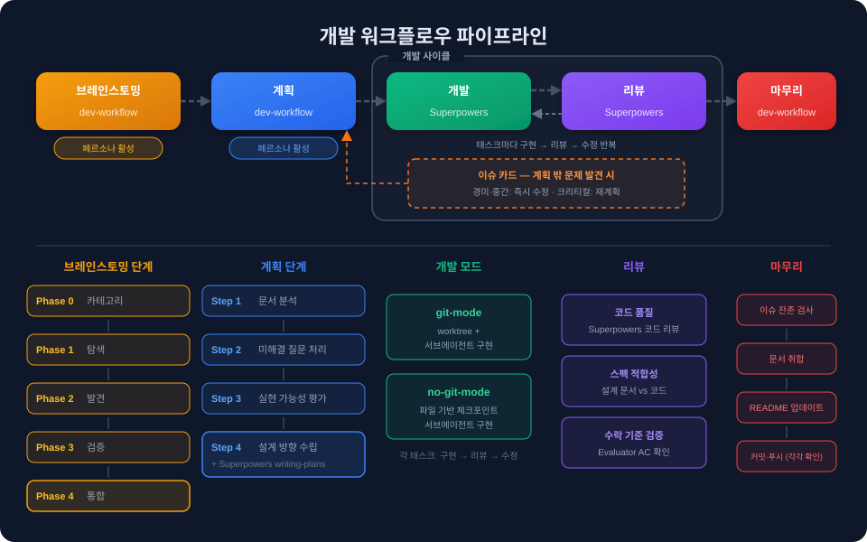
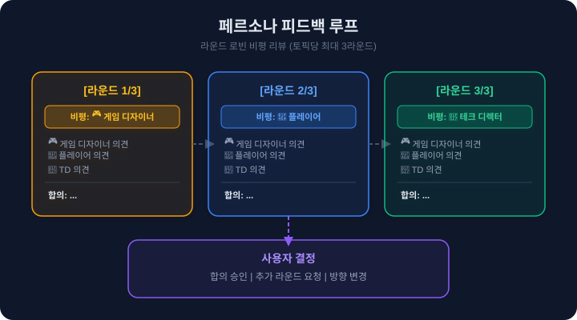
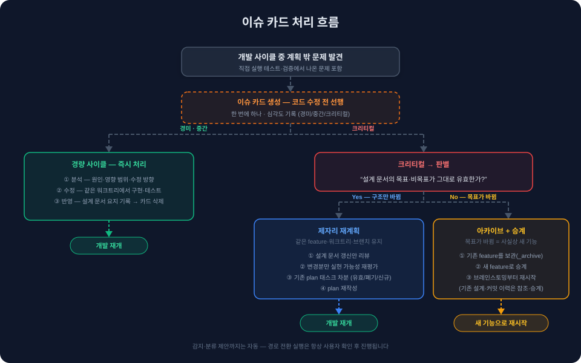

# dev-workflow

> Claude Code plugin for structured development workflows with persona-based feedback loops.

**dev-workflow**는 소프트웨어 개발의 전체 라이프사이클을 **Brainstorm → Plan → Develop → Review → Completion** 5단계로 구조화하는 Claude Code 플러그인입니다. 각 단계에서 다양한 페르소나(Game Designer, Player, TD 등)가 라운드 로빈 방식으로 피드백을 제공하여, 혼자서도 다각적인 관점의 의사결정이 가능합니다.

---

## Why dev-workflow?

AI와 브레인스토밍하면 결국 "맞아요, 좋은 생각이에요"로 끝난 경험이 있을 것입니다. dev-workflow는 이 수긍 편향을 구조적으로 차단합니다.

### 수긍 편향을 구조적으로 차단합니다

AI 브레인스토밍의 구조적 약점 중 핵심 3가지:

- **수긍 편향** — 아이디어를 제안하면 AI는 기본적으로 동의합니다. 비판적 관점이 없습니다.
- **조기 수렴** — 첫 번째 그럴듯한 해결책에 너무 빨리 정착합니다. 대안 탐색이 부족합니다.
- **표면적 요구사항** — "이 기능을 원한다"는 말 뒤에 숨겨진 진짜 문제를 파헤치지 않습니다.

dev-workflow는 [Ouroboros](https://github.com/Q00/ouroboros) 에이전트를 **서브에이전트로 분리 실행**합니다. 메인 컨텍스트와 독립된 에이전트가 각자의 사고방식을 유지하며 비판하기 때문에, 같은 대화 흐름에서 발생하는 편향이 차단됩니다.

### 페르소나(도메인) × 에이전트(사고방식) = 다각적 관점

```
페르소나 = 무엇을 사고하는가     예: 🎮 Game Designer, 👤 Player
에이전트 = 어떻게 사고하는가     예: Socratic Interviewer, Contrarian

Contrarian × 🎮 Game Designer  → "이게 재미있을 거라는 가정이 틀리면?"
Contrarian × 👤 Player         → "사용자가 정말 이걸 원할까?"
Socratic   × 🎮 Game Designer  → "왜 이 메커니즘이 필요한가?"
```

페르소나 N개 × 에이전트 M개 = N×M 고유 사고 조합. 단순히 역할을 나눈 게 아니라, 도메인 지식과 사고방식이 교차하는 조합입니다.

### 세션이 끊겨도 이어집니다

긴 브레인스토밍 세션은 Claude Code의 컨텍스트 창을 소진합니다. dev-workflow는 세 가지 도구를 상황에 따라 전략적으로 사용합니다.

**컨텍스트 관리 전략:**

| 도구 | 언제 | 효과 |
|---|---|---|
| `/compact` | Phase 진행 중 컨텍스트 60~70% 도달 시 | 대화 압축과 세션 상태 유지(페르소나 포함) (세션 내 연장) |
| Phase 파일 (`phase*.md`) | Phase 완료 시 자동 저장 | 외부 메모리 역할 — `/clear` 후에도 복구 가능 |
| HANDOFF.md (`/dev-workflow:save`) | 작업 방향 확인 시 자동 생성 — 워크플로우 내내 유지 | 작업 방향과 진행 국면을 담아 보존, 마무리에서 정리 |

**Phase 경계가 최적의 `/clear` 타이밍:**
각 Phase 파일이 생성된 직후, 중요한 내용이 모두 파일에 저장된 상태입니다. 이 시점에 `/compact`로 세션을 연장하거나, `/clear`로 완전히 초기화해도 안전합니다. brainstorming 스킬이 각 Phase 완료 시 이 안내를 자동으로 제공합니다.

**복구 흐름:**

```
/dev-workflow:save      → HANDOFF.md 생성 (현재 상태 스냅샷)
/clear                  → 컨텍스트 초기화 (또는 새 Claude Code 실행)
/dev-workflow:resume    → 이전 작업 목록 표시 후 선택한 작업 재개
```

```
📋 진행 중인 작업:

  0. ✨ 새 작업 시작
  1. [game-systems] inventory-system (Phase 2: Discovery) — 최근: 2026-03-30
  2. [game-systems] mail-system (Plan: Feasibility) — 최근: 2026-03-28

이어서 진행할 작업을 선택하거나, 새 작업을 시작하세요.
```

> 새 Claude Code를 실행하면 이 목록이 자동으로 나타나지 않습니다. **`/dev-workflow:resume`을 직접 입력**하세요.

---

## Workflow Overview

<p align="center">
  
</p>

5단계 파이프라인이 자동으로 감지되어 실행됩니다:

| 단계 | 담당 | 설명 |
|:---:|:---:|---|
| **BRAINSTORM** | dev-workflow | 아이디어 탐색, 요구사항 발굴, 페르소나 피드백 (5 phases) |
| **PLAN** | dev-workflow | 실현 가능성 평가, 설계 방향 수립, 태스크 분해 |
| **DEVELOP** | Superpowers | 서브에이전트 구현 (git-mode: worktree 격리 / no-git-mode: 파일 기반 체크포인트) — 작업 방향이 결함 수정이면 디버깅, 그 외는 태스크마다 구현→리뷰→수정 반복 |
| **REVIEW** | Superpowers | 전체 브랜치 최종 리뷰 (코드 품질 + 스펙 적합성) + 수락 기준(Evaluator) 검증 |
| **COMPLETION** | dev-workflow | 이슈 잔존 검사 → 문서 취합 → README 반영 → 커밋, 푸시(각각 확인) |

DEVELOP과 REVIEW는 **하나의 개발 사이클**입니다. 리뷰는 개발이 끝난 뒤 오는 별도 절차가 아니라 두 해상도로 개발 안에 박혀 있습니다 — 작업 방향이 결함 수정이 아니면 태스크마다 구현→리뷰→수정 루프가 돌고, 모든 태스크가 끝나면 전체 브랜치를 한 번 더 훑는 최종 리뷰가 관문 역할을 합니다.

작업 방향이 **결함 수정**이면 구현 대신 Superpowers 디버깅으로 넘어갑니다 — 넘기기 전에 에러 원문, 재현 절차와 최근 변경을 브레인스토밍에서 미리 채웁니다.

이 사이클 안에서 계획에 없던 문제가 발견되면(직접 실행 테스트와 검증 포함) 코드를 고치기 전에 **이슈 카드**를 먼저 만듭니다. 경미나 중간 문제는 사이클 안에서 즉시 수정하고, 크리티컬한 문제는 목표가 여전히 유효하면 계획 단계로 되돌아가 재계획하며, 목표 자체가 무효화됐으면 아카이브 후 새 기능으로 승계합니다. 상세 동작은 [이슈 카드](#이슈-카드)를 참조하세요.

---

## Key Features

### Persona Feedback Loop

<p align="center">
  
</p>

Brainstorm과 Plan 단계에서는 **페르소나 기반 피드백 루프**가 활성화됩니다:

- 토픽당 최대 3라운드의 라운드 로빈 토론
- 매 라운드마다 다른 페르소나가 비평 역할(Critical Role)을 담당
- 토론의 첫 의견은 서로 안 보이게 각자 따로 수집합니다 (먼저 나온 의견에 끌려가는 것을 막기 위해) — 판정과 평가 회차는 항상 이 방식입니다
- 각 라운드 끝에 합의(Consensus) 도출
- 사용자가 합의를 승인하거나, 추가 라운드를 요청하거나, 방향을 변경 가능

**기본값 예:**
- 브레인스토밍: 🎮 Game Designer, 👤 Player, 🔧 TD(기술 검증 담당 — Phase 3 합류)
- 계획: 🏛️ Architect, 🔧 Tech Lead, 📋 PM

프로젝트에 맞게 바뀝니다. 정확한 기본값 규칙은 플러그인의 페르소나 확정 단계가 관리합니다.

> 프로젝트별로 `.claude/personas.md`에서 페르소나를 커스터마이징할 수 있습니다.

### Ouroboros 연동

[Ouroboros](https://github.com/Q00/ouroboros) 설치 시 브레인스토밍에 전문 에이전트가 투입됩니다:

| 에이전트 | 역할 |
|---|---|
| 🔎 Socratic Interviewer | 해결책 제안 없이 질문만으로 요구사항의 본질을 파헤침 |
| ⚡ Contrarian | 모든 가정에 도전, 숨겨진 결함을 찾아냄 |
| 🌱 Seed-Architect | 대화 결과를 구조화된 스펙으로 변환 |
| 🔬 Ontologist | "이것은 진짜 무엇인가?" 본질 질문으로 탐색 시작 |

에이전트들은 서브에이전트로 독립 실행되어 수긍 편향 없이 각자의 사고방식을 유지합니다.

> **미설치 시 (Path B — 내장 역할):** Ouroboros 미설치 시에도 에이전트 역할 정의는 플러그인에 내장되어 동일하게 동작합니다 (v1.16.0). Ouroboros MCP 설치 시 validate_seed 등 MCP 전용 도구가 추가됩니다.

### Automatic Session Start

세션 시작 시 경량 부트스트랩만 주입되고, 워크플로우 의도 신호(단계 키워드, docs/design 작업, 재개 발화)가 있을 때만 오케스트레이터가 발동합니다 (v1.12.0). 발동 시 진행 중 작업을 복구하고, 단계를 감지한 뒤 필요한 경우에만 페르소나 확정, VCS 감지와 Ouroboros 감지를 수행합니다. 답이 이미 정해진 요청(사실 조회, 지시가 구체적인 단순 수정)에는 워크플로우 의식이 개입하지 않습니다. 반대로 "이게 왜 안 되지" 같은 **문제 제기는 답이 정해지지 않은 요청**이라 워크플로우가 발동합니다. 진행 중 작업(HANDOFF)이 있으면 첫 메시지가 무엇이든 작업 목록이 제시됩니다.

### 작업 방향 (v1.22.0)

요청의 성격에 따라 이후 흐름이 달라집니다. 브레인스토밍 입구에서 시드를 확인한 직후 한 번 제안드리고 확정합니다.

| 작업 방향 | 언제 | 브레인스토밍에서 확정할 것 | 개발에서 어디로 |
|---|---|---|---|
| 신규 기능 | 없던 것을 새로 만들 때 | 요구 사항을 처음부터 정리한다 | Superpowers 구현 |
| 요구 사항 변경 | 이미 있는 것의 요구 사항 자체가 바뀔 때 | 「무엇이 어떻게 바뀌는가」 (예: `matchid`를 int에서 string으로) | Superpowers 구현 |
| 리팩터링 | 겉보기 동작을 그대로 두고 구조만 손볼 때 | 「다듬을 범위」와 「동작이 안 바뀐 걸 무엇으로 확인하는가」 | Superpowers 구현 |
| 결함 수정 | 동작하던 것이 동작하지 않을 때 | 에러 원문, 재현 절차, 최근 변경, 대상, 수락 기준 다섯 칸 | **Superpowers 디버깅** |

어느 쪽인지는 세 질문으로 갈립니다.

1. **동작하던 것이 멈췄는가?** 그렇다면 결함 수정입니다
2. **뒤집을 기존 요구 사항이 있는가?** 없으면 신규 기능입니다. 코드가 이미 있느냐가 아니라, 기존 문서나 계약의 어떤 문장이 거짓이 되느냐를 봅니다
3. **겉보기 동작이 달라지는가?** 달라지면 요구 사항 변경, 그대로면 리팩터링입니다. 기존 테스트를 고쳐야 하면 앞쪽이고, 그대로 통과해야 하면 뒤쪽입니다

다섯 단계(브레인스토밍 → 계획 → 개발 → 리뷰 → 마무리)는 작업 방향과 무관하게 전부 지나갑니다. 작업 방향이 정하는 것은 각 단계에서 무엇을 확정해야 끝인지, 개발에서 어디로 넘기는지, 마무리에 무엇을 남기는지 셋입니다.

#### 확인 화면

넷을 모두 보여 드리고, 저희가 짚은 자리를 `▶`로 표시합니다. 고르시는 자리가 아니라 판정이 맞는지 대조하시는 자리입니다.

```
📌 지금까지 나눈 이야기를 바탕으로 랭킹 닉네임 누락 작업의 방향을 제안드립니다

작업 방향은 넷이고, 어느 쪽이냐에 따라 브레인스토밍에서 확정할 것이 달라집니다.

    신규 기능         없던 것을 새로 만들 때
                      → 요구 사항을 처음부터 정리한다

    요구 사항 변경     이미 있는 것의 요구 사항 자체가 바뀔 때
                      → 「무엇이 어떻게 바뀌는가」를 확정한다

    리팩터링          겉보기 동작을 그대로 두고 구조만 손볼 때
                      → 「다듬을 범위」와 「동작이 안 바뀐 걸 무엇으로 확인하는가」를 확정한다

  ▶ 결함 수정         동작하던 것이 동작하지 않을 때
                      → 에러 원문과 재현 절차를 비롯한 다섯 칸을 채운 뒤 디버깅으로 넘어간다

✔️ 결함 수정으로 본 이유:

- 어제까지 나오던 닉네임이 오늘 안 나온다는 사용자 말이 있습니다 — 요구 사항 변경이 아닙니다
- ranking_service.go 최근 커밋 3건에 요구 사항이 바뀐 흔적이 없습니다 — 의도한 변경이 아닙니다

1. 진행
2. 의견 있음 — 무엇이 다른지 말씀해주세요
```

근거 줄은 **가장 가까운 다른 방향을 지우는** 사실만 싣습니다. 짚은 것이 맞다고만 말하는 줄은 근거로 치지 않습니다.

「의견 있음」을 고르시면 근거를 다시 보여 드리고 자유롭게 말씀만 하시면 됩니다 — 목록을 다시 내밀지 않습니다. 받은 말을 저희가 작업 방향으로 옮겨 다시 확인받고, 판정이 두 번 틀리면 그 자리에서 넷 중 고르는 화면으로 넘어갑니다.

### Multi-Session Support (HANDOFF)

작업 중 세션이 종료되어도 걱정 없습니다. `HANDOFF.md`를 저장하면 다음 세션에서 자동으로 감지하여 중단 지점부터 이어서 진행합니다.

```
/dev-workflow:save       # 현재 상태 저장 → HANDOFF.md 생성
/clear                   # 컨텍스트 초기화 (또는 새 Claude Code 실행)
/dev-workflow:resume     # 이전 작업 목록 표시 → 선택한 작업 재개
```

| 명령 | 동작 |
|------|------|
| `/dev-workflow:save` | 현재 작업 상태를 HANDOFF.md로 저장 |
| `/dev-workflow:resume` | HANDOFF.md를 탐색하여 작업 복구 |

`/dev-workflow:save` 후 `/clear`로 세션을 초기화하면, 다음 입력 시 자동으로 작업 목록이 표시됩니다. 자동 복구가 안 될 경우 `/dev-workflow:resume`으로 직접 복구할 수 있습니다.

> 상세 사용법은 [Commands Reference](#commands-reference)를 참조하세요.

### Git / Non-Git Support

DEVELOP 단계에서 Superpowers는 `git worktree`를 사용해 격리된 브랜치를 생성한 후 서브에이전트를 투입합니다 (작업 방향이 결함 수정이면 구현 대신 디버깅 서브에이전트가 투입됩니다). 덕분에 작업 중 실수가 있어도 메인 브랜치에 영향을 주지 않습니다.

형상관리 도구로 **SVN, Perforce 등 Git이 아닌 도구**를 사용하는 경우, 또는 VCS 자체가 없는 프로젝트에서는 `git worktree`를 사용할 수 없습니다. dev-workflow는 Git 저장소 여부를 자동으로 감지하여 동작 방식을 전환하므로, Git 여부와 무관하게 동일한 워크플로우를 사용할 수 있습니다.

| 환경 | DEVELOP 단계 동작 |
|---|---|
| Git 저장소 (git-mode) | worktree로 격리된 브랜치 생성 → 서브에이전트 작업(구현, 결함 수정 작업 방향은 디버깅) → 메인 브랜치 병합 |
| Git 아님 (no-git-mode) | worktree 생성 없이 현재 디렉토리에서 직접 작업(구현 또는 디버깅) → 파일 기반 체크포인트로 진행 상황 관리 |

### 이슈 카드

개발 사이클(DEVELOP~REVIEW) 중 계획에 없던 문제가 발견되면 — 직접 실행 테스트나 검증에서 나온 문제를 포함해 — 코드를 고치기 전에 **이슈 카드부터** 만듭니다. "일단 고치고 보자"가 남기는 무질서한 수정을 막고, 분석이 항상 수정에 선행하도록 강제하는 장치입니다.

<p align="center">
  
</p>

- **카드 선행**: 계획 밖 결함을 수정하려는 순간 카드를 먼저 생성 — 한 번에 하나씩 (분석 먼저, 수정은 그다음)
- **경미/중간**: 경량 사이클로 즉시 처리 — 분석 → 수정 → 부모 설계 문서에 요지 반영 → 카드 삭제
- **크리티컬**: "설계 문서의 목표와 비목표가 그대로 유효한가?" 판별로 분기 — 유효하면 계획 단계로 돌아가 재계획, 무효화됐으면 아카이브 후 새 feature로 승계
- 이미 완료(complete)된 기능에서 발견된 문제는 이슈 카드가 아니라 별도 feature로 처리합니다
- 마무리(COMPLETION) 진입 시 미해소 카드가 남아 있으면 먼저 확인을 요청합니다

> 🔧 내부 스킬: `workflow-orchestrator` 「Issue Lifecycle」

### Project Rules Injection (`.claude/rules/`)

프로젝트별 코딩 스타일, 커밋 규칙과 아키텍처 원칙 같은 팀 표준을 CLAUDE.md에서 분리하여 `.claude/rules/*.md`로 도메인 분리할 수 있습니다. dev-workflow는 3계층 Defense in Depth 메커니즘으로 규칙을 자동 주입, 전파와 검증합니다.

| 계층 | 시점 | 동작 |
|---|---|---|
| 1차 — SessionStart 훅 | 모든 세션 시작 | `.claude/rules/*.md` 일괄 → `additionalContext` 자동 주입 |
| 2차 — 단계별 프롬프트 | DEVELOP(작업 방향별 목적지) / REVIEW / COMPLETION / PLAN 진입 | `applies-to` 매칭 규칙을 서브에이전트 호출 프롬프트에 명시 첨부 (결함 수정 작업 방향은 디버깅 호출 프롬프트에 첨부) |
| 3차 — REVIEW 검증 + 자동 수정 | REVIEW 단계 | `type`별 검증자 라우팅 (semantic→code-reviewer, quantitative/structural→Evaluator) + 위반 시 자동 수정 라운드 (별도 커밋 + 테스트 재실행 + 실패 시 자동 롤백) |

**규칙 작성:** `/dev-workflow:add-rule` 명령으로 인터랙티브하게 frontmatter 자동 설정 후 권장 템플릿 골격 생성. 자세한 메커니즘은 [project-customization 도메인 문서](docs/design/dev-workflow/project-customization.md), 마이그레이션 가이드는 [docs/guides/migrate-claude-md.md](docs/guides/migrate-claude-md.md)를 참조하세요.

**후방 호환:** `.claude/rules/` 디렉토리가 없는 기존 프로젝트는 변경 없이 동일하게 동작합니다.

---

## Quick Start

> 설치는 [Installation](#installation)을 먼저 참조하세요.
> Ouroboros MCP 연동 기준 예시입니다. Ouroboros MCP 미설치 시에는 "🔗 Ouroboros 연동: MCP 모드" 표시만 생략됩니다 — 에이전트 기반 동작은 동일합니다.

### BRAINSTORM

`/dev-workflow:resume`을 실행하면 작업 상태를 확인합니다:

```
📋 진행 중인 작업이 없습니다.

  0. ✨ 새 작업 시작

새 작업을 시작하세요.
```

**사용자:** 알림 기능을 추가하려 해. 요구사항은 이래:
- 알림 타입: 이메일, 푸시, SMS
- 사용자별 알림 설정 (채널 선택, 수신 여부)
- 채널별 실패 시 재시도 (채널마다 정책 다름)
- 알림 이력 30일 보관 (감사용 + 사용자 표시용 분리)

```
✅ 페르소나 확정:
  👤 Product Manager / 🔧 Backend Engineer / 📱 Client Developer (국면3 활성화)
🔗 Ouroboros 연동: MCP 모드
```

🔬 **본질 질문 [Ontologist]:**
> **[Essence]** 알림이 진짜 무엇인가?
>
> 1. 정보를 전달하는 채널 — 고르면: 전달 성공률과 비용이 설계의 중심이 됩니다
> 2. 사용자와 시스템 간 신뢰 계약 — 고르면: 무엇을 언제 보내지 않을지가 설계의 중심이 됩니다
>
> 0\. 이 중에 없음 — 자유롭게 말씀해주세요

**사용자:** 2번.

📋 **핵심 질문 [에이전트: Socratic] — ❓ 질문 1/2 : 채널 설정**

> **배경/힌트:**
>
> 마케팅 알림과 보안 알림의 수신 정책이 같아야 하는지가 여기서 갈립니다.
>
> 알림 설정을 "끄는" 사용자가 원하는 것은 무엇입니까?
>
> 1. 알림 자체를 안 받겠다 — 고르면: 설정이 하나뿐이라 단순해지지만 보안 알림도 함께 막힙니다
> 2. 특정 채널이나 타입만 차단하겠다 — 고르면: 채널별과 타입별 설정이 생기고 저장할 상태가 늡니다
>
> 0\. 이 중에 없음 — 자유롭게 말씀해주세요

**사용자:** 2번. 이메일은 받고 푸시는 끄는 식으로. 타입별로도 되면 좋겠어.

[라운드 1/3] [비판: 🔧 Backend Engineer] [에이전트: Contrarian]

👤 **Product Manager** [Socratic]:
> 채널 × 알림 타입 매트릭스 설정이라면 UI 복잡도가 올라갑니다.
> 사용자가 실제로 이 세분화가 필요한가요, 아니면 "알림 끄기"로 충분한 사용자가 더 많지 않을까요?

🔧 **Backend Engineer** [Contrarian]:
> 재시도 정책을 채널별로 분리하면 알림 발송 로직이 채널 어댑터 패턴으로 가야 합니다.
> 이미 이 패턴을 쓰고 있다면 괜찮지만, 아니라면 지금 설계해야 합니다 — 나중에 추가하면 비용이 큽니다.

📱 **Client Developer** [Socratic]:
> 30일 이력을 사용자에게 보여줄 때 어떤 정보를 표시하나요?
> "발송 성공/실패 여부"와 "사용자가 읽었는지 여부"는 다른 데이터입니다.

**합의:** 알림 설정은 `(사용자 × 채널 × 알림 타입)` 3중 매트릭스로 설계.
채널 어댑터 패턴 도입. 이력은 감사용(서버 내부) + 사용자 표시용(30일 읽음 여부 포함) 분리.

### PLAN

```
── Feasibility Assessment ────────────────────────────

[채널별 재시도 정책 (채널 어댑터 패턴)]
  👤 Product Manager: ✅ 비즈니스 요구사항과 일치
  🔧 Backend Engineer: ✅ 채널 어댑터로 확장성 확보 가능
  📱 Client Developer: ✅ 클라이언트 영향 없음
  → 종합 판정: ✅ FEASIBLE

[알림 설정 3중 매트릭스 (사용자 × 채널 × 타입)]
  👤 Product Manager: ⚠️ 설정 UI 복잡도 증가 — 초기 스코프 조정 검토
  🔧 Backend Engineer: ✅ DB 스키마로 표현 가능, 조회 성능 인덱싱 필요
  📱 Client Developer: ⚠️ 설정 동기화 로직 복잡도 증가
  → 종합 판정: ⚠️ CAUTION — 초기 릴리스는 채널 단위만, 타입별 설정은 v2

── 판정 요약 ──────────────────────────────────────────
✅ FEASIBLE:    1개
⚠️ CAUTION:     1개
🚫 RENEGOTIATE: 0개
──────────────────────────────────────────────────────
```

→ plan.md 생성 완료: `docs/design/your-project/notification-feature/plan.md`

---

> DEVELOP → REVIEW → COMPLETION 단계는 [Workflow Stages in Detail](#workflow-stages-in-detail)을 참조하세요.

### 주요 시나리오

#### 이전 작업 이어가기

새 세션을 시작하면 자동으로 `HANDOFF.md`를 탐색합니다:

```
📋 진행 중인 작업:

  0. ✨ 새 작업 시작
  1. [your-project] notification-feature (Phase 2: Discovery) — 최근: 2026-03-31
  2. [your-project] auth-system (PLAN 대기, ⚠️ HANDOFF 없음) — 최근: 2026-03-28

이어서 진행할 작업을 선택하거나, 새 작업을 시작하세요.
```

`/dev-workflow:save`로 현재 작업 상태를 저장하고, `/clear` 후 새 메시지를 입력하면 자동 복구됩니다.

#### 설계 문서가 이미 있는 경우

설계 문서를 제공하면 BRAINSTORM을 건너뛰고 PLAN부터 시작합니다:

```
사용자: "이 설계 문서로 계획 세워줘" (설계 문서 경로 제공)
```

#### 기존 설계 문서 참조하기

브레인스토밍이나 계획 중 기존 완료된 설계 문서를 참조할 수 있습니다:

```
사용자: "기존 설계 문서 목록 보여줘"
사용자: "auth-system 설계 문서 로드해줘"
```

#### 페르소나 커스터마이징

`.claude/personas.md`를 생성하면 프로젝트에 맞는 페르소나를 사용할 수 있습니다. 파일이 없는 경우, 설계 문서 확정 또는 워크플로우 완료 시점에 이번 세션 페르소나가 `.claude/personas.md`로 자동 저장됩니다 (1줄 고지 후, 원치 않으면 삭제 가능).

---

## Installation

### 1. Install dev-workflow

```bash
/plugin marketplace add sangteak/dev-workflow
/plugin install dev-workflow@dev-workflow-marketplace
```

### 2. Setup Dependencies

권장 플러그인([Superpowers](https://github.com/obra/superpowers), [Ouroboros](https://github.com/Q00/ouroboros))을 한 번에 설치합니다:

```bash
/dev-workflow:setup
```

또는 수동으로 설치할 수 있습니다:

```bash
# Superpowers (필수) — DEVELOP/REVIEW 자동화
/plugin install superpowers@claude-plugins-official

# Ouroboros (권장) — 페르소나 강화 브레인스토밍
/plugin marketplace add Q00/ouroboros
/plugin install ouroboros@ouroboros
```

> **선택 요건:** 도메인 머지 도구(`/dev-workflow:merge-to-domain`의 MCP 서버)와 `/dev-workflow:search-ignore`는 **Node.js 18+**가 필요합니다 — 없으면 이 둘만 비활성되며, 나머지 워크플로우는 영향이 없습니다. `/dev-workflow:setup`이 자동으로 진단합니다.

### Update

```bash
/plugin update dev-workflow@sangteak-dev-workflow
```

### Manual Installation (Alternative)

마켓플레이스 설치가 동작하지 않을 경우:

```bash
git clone https://github.com/sangteak/dev-workflow.git
```

프로젝트의 `.claude/settings.json`에 추가:

```json
{
  "extraKnownMarketplaces": {
    "dev-workflow": {
      "source": {
        "source": "local",
        "directory": "/path/to/dev-workflow"
      }
    }
  },
  "enabledPlugins": {
    "dev-workflow@dev-workflow": true
  }
}
```

---

## Commands Reference

dev-workflow가 제공하는 슬래시 커맨드입니다. 워크플로우 자동 흐름과 별개로, 사용자가 명시적 의도를 가지고 호출하는 커맨드들입니다.

---

### `/dev-workflow:save` — 세션 저장

**언제 쓰는가:** 작업 중 세션을 종료하기 전 (컨텍스트 창이 거의 찼을 때)

**무엇을 저장하는가:** 현재 작업의 진행 단계, 확정된 결정 사항, 미완료 항목을 `HANDOFF.md`에 기록

**왜 필요한가:** Claude Code의 컨텍스트 창은 무한하지 않습니다. 긴 브레인스토밍 세션은 창을 소진합니다. 저장 없이 `/clear`하면 작업 컨텍스트가 모두 사라집니다.

```
/dev-workflow:save
→ docs/design/[카테고리]/[기능명]/HANDOFF.md 생성
```

---

### `/dev-workflow:resume` — 작업 복구

**언제 쓰는가:** 새 세션에서 이전 작업을 이어가려 할 때

**자동 감지와의 차이:** 세션 시작 시 HANDOFF.md를 자동으로 탐색하지만, 자동 감지가 안 될 경우 이 커맨드로 수동 복구합니다.

```
/dev-workflow:resume
→ HANDOFF.md 탐색 → 작업 목록 표시 → 선택한 작업 재개
```

---

### HANDOFF 생명주기

```
작업 중 컨텍스트가 부족해짐
  ↓
/dev-workflow:save          → HANDOFF.md 생성
  ↓
/clear                      → 세션 초기화
  ↓
새 메시지 입력               → HANDOFF.md 자동 감지
  ↓
작업 목록 표시               → 이어서 진행
```

저장 후 `/clear`로 세션을 초기화하면, 다음 입력 시 **자동으로 작업 목록이 표시됩니다.** 자동 복구가 안 될 경우 `/dev-workflow:resume`으로 직접 복구할 수 있습니다.

---

### `/dev-workflow:search-ignore` — Perforce 저장소의 검색 제외

**언제 쓰는가:** Perforce 저장소(예: Unreal 프로젝트)에서 Claude의 Grep 검색이 `Intermediate/` 같은 빌드 산출물까지 훑어 느리거나 결과가 섞일 때

**무엇을 하는가:** 세션 폴더의 `.p4ignore`(없으면 `p4ignore.txt`) 폴더 줄 가운데 디스크에 있는 것을 후보로 보여 주고, 확인받은 줄을 `.claude/ignore.yaml`에 기록한 뒤 `.ignore`를 만듭니다. 끝에 Grep으로 제외가 먹는지 확인합니다. 더 뺄 폴더는 `.claude/ignore.yaml`의 user 부분에 적고 다시 실행합니다.

```
/dev-workflow:search-ignore
→ 후보 화면 확인 → .claude/ignore.yaml, .ignore 생성 → Grep 확인
```

**알아 둘 것:**
- 세션은 `.p4ignore`가 있는 폴더에서 엽니다. 위쪽 폴더를 찾아 올라가지 않습니다.
- 줄은 `.p4ignore`에서 그대로 옮깁니다. 가운데 `/`가 든 줄(`Saved/Autosaves/`)은 `.ignore`에서 세션 폴더 기준이라 그 자리만 빠집니다. 어느 깊이든 빼려면 user 부분에 `- "**/Saved/Autosaves/"`처럼 따옴표와 `**/`를 붙여 적습니다.
- Glob 도구는 기본으로 `.ignore`를 따르지 않습니다. 적용하려면 `.claude/settings.local.json`의 `env`에 `"CLAUDE_CODE_GLOB_NO_IGNORE": "false"`를 넣고 세션을 다시 엽니다.
- `.ignore`는 `p4 reconcile`에 새 파일로 잡히고, 터미널의 `rg`에도 적용됩니다. `.claude/ignore.yaml`은 `.claude/`를 제출에서 빼는 저장소라면 제출되지 않으므로, 팀원이 `.ignore`만 받고 이 명령을 다시 실행하면 원래 작성자의 user 줄이 빠집니다.
- `.ignore`는 대소문자를 가립니다.
- macOS, Linux와 WSL에서는 Claude Code의 Grep 도구가 기본 도구 목록에 없을 수 있어 효과가 다를 수 있습니다.
- `P4IGNORE`로 다른 이름을 쓰는 저장소, 하위 폴더에 따로 있는 `.p4ignore`는 다루지 않습니다.
- Node.js 18+가 필요합니다.

---

### `/dev-workflow:design-summary` — 설계 문서 통합 요약

**언제 쓰는가:** 여러 설계 문서의 내용을 한눈에 파악하고 싶을 때

```
/dev-workflow:design-summary game-systems
```

---

### `/dev-workflow:add-rule` — 프로젝트 규칙 생성

**언제 쓰는가:** `.claude/rules/`에 새 규칙 파일(코딩 스타일, 커밋 형식, 리뷰 체크리스트 등)을 만들 때

**인터랙티브 흐름:** 이름 → 적용 단계(develop/review/completion/plan/all) → 종류(semantic/quantitative/structural) → 자동 수정 정책(true/confirm/false) → 파일 생성

```
/dev-workflow:add-rule
→ frontmatter 자동 설정 + 권장 템플릿 골격 생성 → .claude/rules/[이름].md
```

**관련 가이드:**
- 권장 템플릿: [docs/templates/rule-template.md](docs/templates/rule-template.md)
- CLAUDE.md 마이그레이션: [docs/guides/migrate-claude-md.md](docs/guides/migrate-claude-md.md)
- 메커니즘 상세: [project-customization 도메인 문서](docs/design/dev-workflow/project-customization.md)

---

> **설치 커맨드** (`/dev-workflow:setup`)는 [Installation](#installation)을 참조하세요. `.claude/rules/` 디렉토리 초기화 옵션을 제공합니다.
>
> 워크플로우 진행 중 결정할 사항이 생기면 dev-workflow가 사용자에게 질문합니다. 기본은 **한 번에 하나씩** 묻는 방식이고, 사용자가 요청하면 방식을 바꿀 수 있습니다 — "다 보여줘"라고 하면 남은 질문을 한꺼번에 보여주고, "알아서 해줘"라고 하면 남은 결정을 페르소나 추천값으로 일괄 확정한 뒤 요약을 제시합니다. 이 전환은 사용자가 명시적으로 말할 때만 일어나며, 먼저 넘겨짚어 바꾸지 않습니다.
>
> 결정을 요청받으면 그 화면 안에서 판단에 필요한 정보를 함께 받습니다 — **선택지가 갈리는 원인이 맨 앞에** 오고, 토론에서 확인된 사실(✔️)과 확인하지 못한 것(⚠️), 토론이 어디로 수렴했는지. 근거의 출처는 화면에 오르지 않고 "출처 보여줘"로 펼칩니다. 아이콘은 제목과 항목 머리와 이름표에서만 강조로 쓰이고, 설명 문장은 낱말로 씁니다 — 판정은 주의와 통과와 재협의로 부르고 확인 상태는 확인됨과 확인 못 함으로 써서, 읽다가 기호의 뜻을 되짚느라 멈추지 않게 합니다. 펼친 화면은 "📎 근거 — 아웃바운드 줄" 머리줄 아래 그 줄과 들여쓴 근거 한 줄이 짝으로 나옵니다. 그 결정 전에 토론이나 조사가 있었던 경우에는, 화면 맨 위에 짧은 설명 문단이 먼저 나옵니다 — 왜 이 문제가 생겼는지, 무엇이 걸려 있는지, 그것들이 어떤 순서로 움직이는지, 흐름의 어느 자리에서 벌어지는 일인지 중에서 그 결정에 필요한 것만 담습니다. 그리고 단계를 못 잡았을 때 나오는 화면처럼 선택지를 늘어놓는 자리에서는, 선택지 이름에 지금 하고 있는 일의 이름이 들어갑니다 — "브레인스토밍"이 아니라 "매칭 진입 브레인스토밍"처럼요. 다른 화면들은 다음 판에 같은 방식으로 손봅니다. 답을 이미 아는 자리(작업 방향 확인, 계획 단계의 재협의)에서는 선택지를 늘어놓는 대신 이렇게 파악했다는 판정과 그 근거를 먼저 보여 주고, 진행할지 의견이 있는지만 물어봅니다. 그중 작업 방향 확인은 **후보 넷을 모두 지도로 깔고 짚은 자리를 `▶`로 표시**합니다 — 고르시는 것이 아니라, 무엇 중에서 고른 판정인지 대조하실 수 있게 하는 것입니다.
>
> 결정이 아니라 **탐색을 위한 질문**을 받을 때도 답의 후보가 둘 이상으로 셀 수 있으면 번호가 붙습니다. 그리고 그런 질문에는 **0번 탈출구가 늘 함께 나옵니다** — 제시된 후보 밖으로 답하실 수 있는 자리입니다. 후보를 셀 수 없는 서술형 질문만 번호 없이 열린 채로 나갑니다.
>
> 화면에 쓰는 말은 **주니어와 시니어 사이의 개발자**를 기준으로 씁니다. 리팩터링과 스택 트레이스처럼 이미 자리 잡은 표준 용어는 그대로 쓰고, 함수, 타입, 필드, 설정 키와 외부 라이브러리의 기능 이름은 번역하지 않습니다 — 처음 나오는 자리에서만 괄호로 뜻을 짧게 붙입니다. 그 저장소나 도메인 안에서만 통하는 말만 풀어 씁니다. 화면에 오르는 도메인 명사는 그 세션의 코드 이름 목록이나 지금 다루는 코드 자리에서 실제로 나오는 이름이어야 합니다 — `Assignment`를 "배정"으로 옮겨 쓰지 않고, 코드에 없는 개념은 이름을 짓는 대신 문장으로 풀어 씁니다. 이 목록은 브레인스토밍 국면 0에서 만들어져 `HANDOFF.md`와 같이 살고 마무리 때 함께 지워집니다 — 저장소에 남는 사전 파일은 없습니다. 나열은 가운뎃점(·) 대신 쉼표와 "와/과"로 잇고, 따로 보여야 하면 줄을 나눕니다.

---

## Workflow Stages in Detail

### BRAINSTORM (5 Phases)

| Phase | 이름 | 산출물 | 설명 |
|:---:|---|---|---|
| 0 | Category | - | kebab-case 카테고리 결정, 이야기에 나온 코드 자리에서 타입 이름을 뽑아 세션 안에만 두고 한 줄로 알립니다 (`📇 코드 이름 목록 N개를 이 세션에 두었습니다 — [자리]`) |
| 1 | Exploration | `phase1_exploration.md` | 제약 없이 요구사항 탐색 |
| 2 | Discovery | `phase2_discovery.md` | 미정의 영역 발굴 및 보완 |
| 3 | Validation | `phase3_validation.md` | 기술적 실현 가능성 검증 |
| 4 | Consolidation | `[feature].md` | 10섹션 표준 설계 문서 생성 |

- Phase 1~3에서 페르소나 피드백 루프 활성화
- Phase 파일은 생성 후 **불변** (수정 불가, 스냅샷 역할)
- Phase 4에서 모든 내용을 통합한 설계 문서(SSOT) 자동 생성

> 🔧 내부 스킬: `brainstorming`, `persona-resolution`

### PLAN (4 Steps)

| Step | 내용 |
|:---:|---|
| 1 | 브레인스토밍 문서 분석 |
| 2 | OPEN_QUESTIONS 해소 |
| 3 | 실현 가능성 평가 (Architect, Tech Lead, PM) |
| 4 | 설계 방향 수립 → Superpowers `writing-plans` 실행 |

- 요구사항별 판정: ✅ FEASIBLE / ⚠️ CAUTION / 🚫 RENEGOTIATE
- RENEGOTIATE 항목은 사용자 결정 없이 진행하지 않음
- CAUTION 항목은 페르소나 피드백 루프를 통해 접근 방식 합의

> 🔧 내부 스킬: `plan-stage`

### DEVELOP

작업 방향이 위임 대상을 가릅니다 — 신규 기능, 요구 사항 변경과 리팩터링은 Superpowers `subagent-driven-development`에, 결함 수정은 Superpowers `systematic-debugging`에 위임됩니다 (디버깅 경로는 아래 git/no-git 구분과 태스크 루프를 적용하지 않습니다):

- **git-mode**: worktree를 생성하여 격리된 환경에서 구현
- **no-git-mode**: 현재 디렉토리에서 직접 작업, 파일 기반 체크포인트
- 모든 태스크가 끝나도 바로 커밋하지 않습니다 — 아래 COMPLETION 단계로 넘어가 마무리를 기다립니다

> 🔧 내부 스킬: Superpowers `subagent-driven-development` (결함 수정은 `systematic-debugging`)

### REVIEW

Superpowers `requesting-code-review`에 위임됩니다:

- Code Quality Review (코드 품질)
- Spec Compliance Review (설계 문서 대비 적합성)
- Evaluator AC 검증은 Ouroboros 설치 여부와 무관하게 실행됩니다 (수락 기준이 있는 경우)

> 🔧 내부 스킬: Superpowers `requesting-code-review`

### COMPLETION

개발이 끝나면 커밋 전에 문서 정리, README 반영과 커밋 메시지 규칙 적용까지 마치는 마무리 절차가 실행됩니다. 아래 세 가지 방법 중 아무거나 사용하면 됩니다.

1. **자연어로 요청** — "마무리해줘", "wrap up" 같은 말 한마디면 충분합니다.
2. **`/dev-workflow:finish` 명령** — 감지를 거치지 않고 즉시 마무리 절차로 들어갑니다.
3. **개발 완료 직후 안내에 응답** — 태스크가 다 끝나면 Claude가 먼저 마무리 여부를 묻습니다. 이때 승낙하면 됩니다.

개발 중 발견한 결함을 먼저 처리하느라 마무리 타이밍을 놓쳤어도 걱정할 필요 없습니다 — 작업이 하나 일단락될 때마다 Claude가 보고 메시지 끝에 `🔔 마무리 대기: [기능명] — /dev-workflow:finish 또는 "마무리해줘"` 줄을 붙여 아직 마무리가 남아 있음을 알려줍니다. 이 표시가 보이면 위 세 가지 방법 중 아무 때나 골라 마무리하면 됩니다.

마무리 절차가 실행되면 다음 순서로 진행됩니다:

0. **이슈 잔존 검사** — `issues/` 하위 미해소 카드가 있으면 목록을 제시하고 확인 (처리 후 마무리 / 보류하고 마무리)
1. **문서 취합** — phase/plan 파일을 feature 설계 문서에 통합 + status를 `complete`로 마킹
2. **README 영향 판단** — 변경 내용에 따라 README 업데이트 제안
3. **커밋 규칙 주입** — rules-injection (`applies-to: completion` 규칙을 커밋 메시지 작성에 반영)
4. **커밋 제안** — 사용자 확인 후 커밋 실행
5. **푸시 제안** — 커밋 성공 후 별도 확인 (커밋만 하고 마칠 수 있음)

터미널 상태 표시줄(statusline)을 쓰고 있다면, `/dev-workflow:setup` 실행 시 "마무리를 기다리는 기능이 있다"는 표시를 상태 표시줄에 통합할지 선택할 수 있습니다 (선택 사항, 기존 statusline 사용자 한정).

> 🔧 내부 스킬: `document-consolidation` (consolidate-main 모드)

#### 도메인 통합 (선택, 관리자만)

작업자의 Completion이 끝난 뒤, 프로젝트 리더(관리자)는 별도 시점에 다음 명령으로
도메인 문서 통합을 진행할 수 있습니다 (v1.11.0+):

```
/dev-workflow:merge-to-domain [카테고리]
```

`docs/design` 스캔으로 `status: complete` feature를 자동 식별 → intelligent merge.
5단계 알고리즘(학습→학습→계획→적용→검증) + Architect 라운드 + dry-run 안전 게이트.
기계 단계(digest 추출, 머지 검증과 체크포인트)는 번들 MCP 도구가 수행합니다 (v1.17.0+) —
Node.js 18+ 필요, 도구 부재 시 머지가 중단됩니다 (`/dev-workflow:setup`으로 진단).

> 🔧 내부 스킬: `merge-to-domain` (관리자 전용)
> ℹ️ `document-consolidation`은 v1.18.0부터 consolidate-main 단일 모드입니다 (도메인 통합은 `merge-to-domain`이 전담).

---

**Commands (슬래시 명령 별칭):**

```
commands/
├── save.md                 ← /dev-workflow:save 즉시 실행
├── resume.md               ← /dev-workflow:resume 즉시 실행
├── design-summary.md       ← /dev-workflow:design-summary → 설계 문서 통합 요약
├── setup.md                ← /dev-workflow:setup → 권장 플러그인 의존성 설치/검증
├── add-rule.md             ← /dev-workflow:add-rule → 프로젝트 규칙 추가
└── merge-to-domain.md      ← /dev-workflow:merge-to-domain → 관리자 도메인 머지 (v1.11.0+)
```

> 콘솔 자동완성에서 `/save` 입력 → `dev-workflow:save` 선택 → 엔터로 즉시 실행됩니다.

**보조 파일:**

```
.claude/personas.md         ← 프로젝트별 페르소나 오버라이드 (선택)
tasks/lessons.md            ← 세션 간 학습 누적 (자기개선 루프)
docs/design/[카테고리]/[기능명]/plan.md  ← Superpowers writing-plans 산출물
```

---

## Configuration

### Custom Personas

프로젝트 루트에 `.claude/personas.md`를 생성하여 페르소나를 커스터마이징할 수 있습니다:

```markdown
## brainstorm
- 🎮 Game Designer: 게임 메커니즘과 플레이어 경험 전문가
- 👤 Player: 최종 사용자 관점 대변
- 🔧 TD: 기술적 실현 가능성 검증

## plan
- 🏛️ Architect: 시스템 아키텍처 설계
- 🔧 Tech Lead: 기술 리더십 및 구현 전략
- 📋 PM: 일정, 리소스, 리스크 관리
```

### Self-Improvement Loop

세션에서 수정을 받을 때마다 `tasks/lessons.md`에 자동으로 교훈이 기록됩니다. 다음 세션 시작 시 이 교훈을 내부적으로 읽고 같은 실수를 반복하지 않습니다.

---

## FAQ

**Q: 설정할 게 너무 많아 보이는데, 정말 다 해야 하나요?**
A: 아닙니다. 설치 후 세션을 시작하고 아무 메시지나 입력하면 됩니다. 단계 감지부터 페르소나 적용까지 필요한 시점에 자동으로 처리됩니다. Superpowers와 Ouroboros는 권장 사항이며, 없어도 브레인스토밍과 계획 단계는 완전히 동작합니다.

**Q: Superpowers나 Ouroboros를 몰라도 사용할 수 있나요?**
A: 네. dev-workflow가 이 플러그인들과의 연동을 추상화합니다. 흐름을 따라가면 자연스럽게 결과물이 나옵니다. 내부에서 어떤 플러그인이 동작하는지 알 필요가 없습니다.

**Q: Superpowers 없이도 사용할 수 있나요?**
A: BRAINSTORM과 PLAN 단계는 독립적으로 동작합니다. 하지만 DEVELOP과 REVIEW 단계는 Superpowers가 필요합니다.

**Q: Git이 없는 프로젝트에서도 동작하나요?**
A: 네. Git 저장소가 아니면 자동으로 no-git-mode로 전환되어 worktree 없이 파일 기반으로 진행합니다.

**Q: 페르소나를 바꿀 수 있나요?**
A: BRAINSTORM/PLAN 진입 시 페르소나 적용 선언 때 변경을 요청할 수 있고, `.claude/personas.md`로 프로젝트별 기본값을 설정할 수 있습니다 (저장된 페르소나는 자동 적용됩니다).

**Q: 여러 기능을 동시에 작업할 수 있나요?**
A: 네. 각 기능은 `docs/design/[category]/[feature]/` 하위에 독립적으로 관리되며, HANDOFF.md를 통해 세션 간 전환이 가능합니다.

---

## License

MIT
